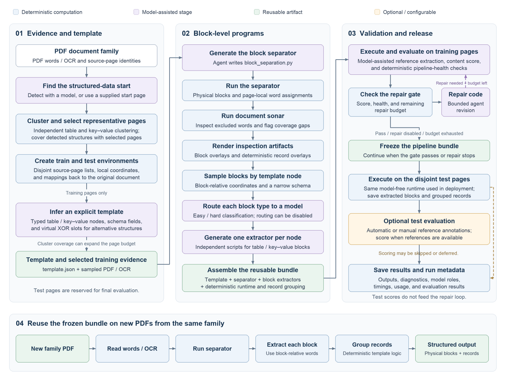
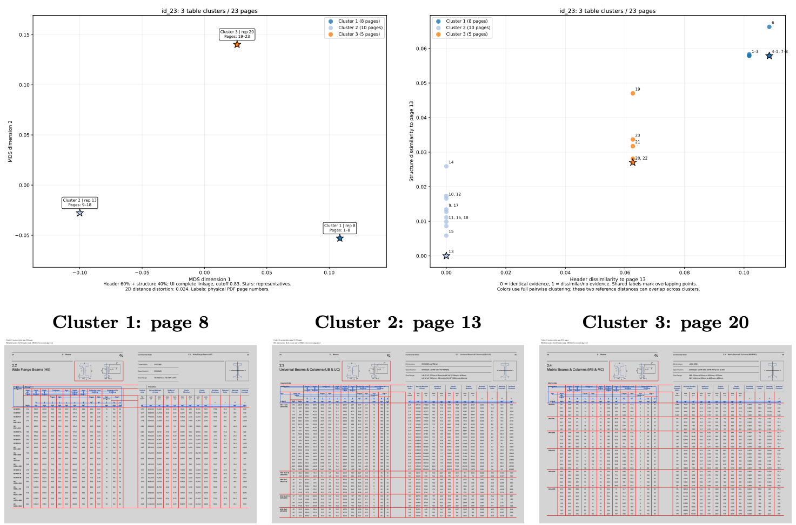
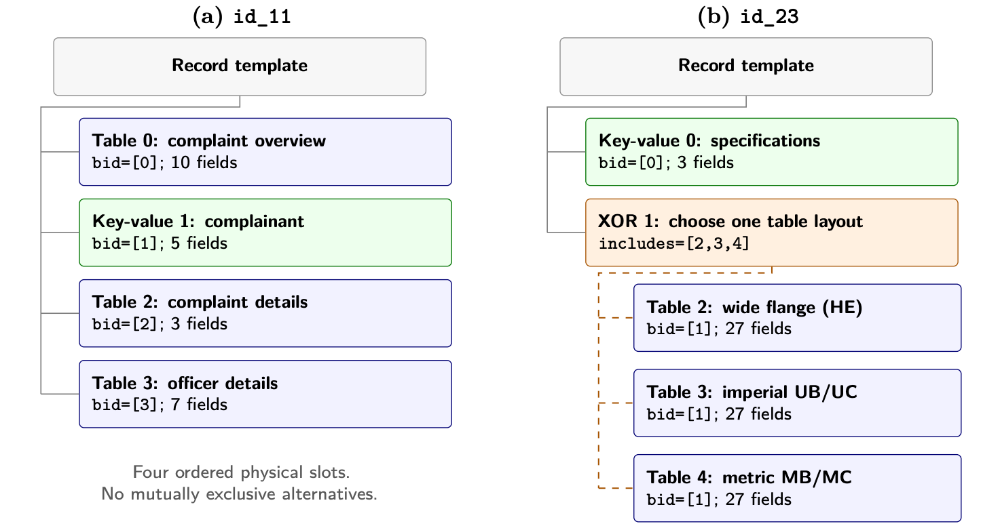
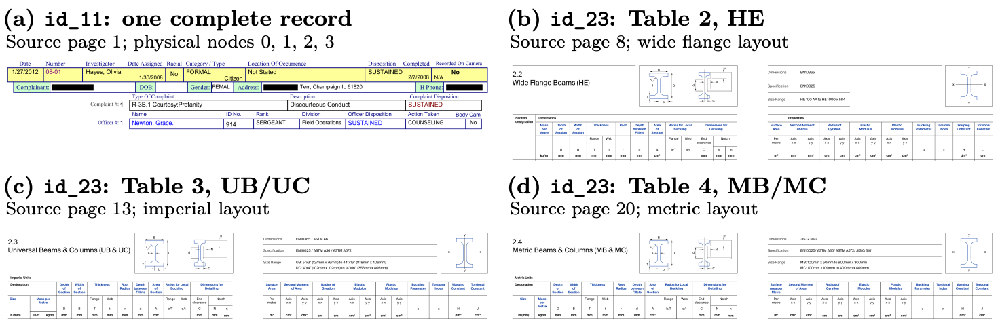
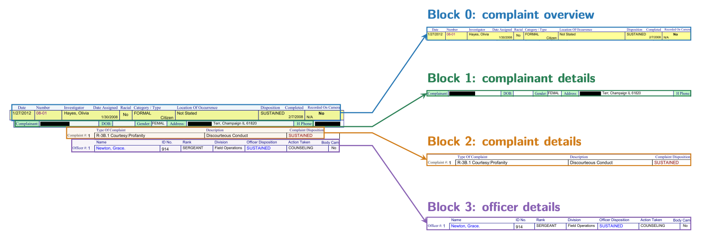
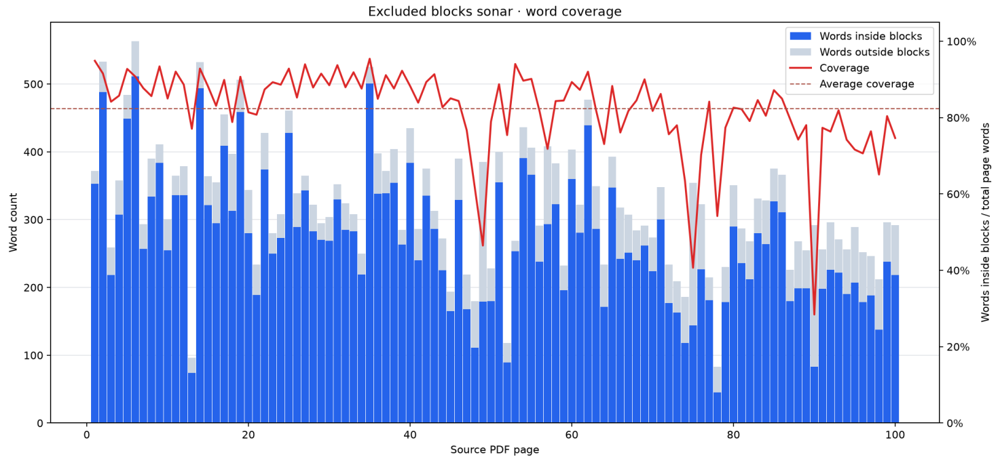

# TWIX 2

TWIX 2 learns a reusable structured-data extractor from a small sample of a
PDF document family. It selects representative pages, infers their tables and
key-value sections, and generates Python programs for block separation and
extraction. The resulting pipeline processes further PDFs with the same layout
without model calls.

**Project report:** [Riccardo Bollati — TWIX 2: a framework for reliable data
extraction at scale from templatized documents](project_report.pdf).
The [dataset/](dataset/) folder contains the 23 PDFs under their thesis identifiers.

## Workflow



*Report Figure 2.1. Models help construct the extractor; the exported bundle
performs subsequent extraction deterministically. Test evaluation stays outside
the construction and repair loop. Repair is optional and was disabled in the
thesis experiments.*

1. Extract words and coordinates, then find the first structured-data page.
2. Cluster table and key-value layouts independently and select training pages
   that cover their detected variations. Reserve disjoint pages for testing.
3. Infer an explicit template containing fields, block order, and alternative
   layouts.
4. Generate and validate the block separator, inspect coverage, and collect
   samples for each physical template node.
5. Generate one extractor per node and assemble the portable pipeline.
6. Evaluate on training pages, optionally repair the generated code, then run
   the finished pipeline on held-out pages and save the outputs.

## Setup

Requirements: Python 3.14, the OpenCode CLI available as `opencode`, and an
OpenRouter API key. Both direct model calls and OpenCode sessions use OpenRouter.

```bash
python3.14 -m venv env
source env/bin/activate
python -m pip install -r requirements.txt
cp .env.example .env
```

Set `OPENROUTER_API_KEY` in `.env`. The main model settings are:

| Setting | Role |
| --- | --- |
| `OPENROUTER_MODEL` | Direct operational calls, such as front-matter detection |
| `OPENROUTER_TEMPLATE_INFERENCE_MODEL` | Template inference; defaults to GPT-5.4 |
| `OPENCODE_EASY_MODEL` / `OPENCODE_HARD_MODEL` | Code generation and difficulty routing |
| `OPENROUTER_GROUND_TRUTH_MODEL` | Training and held-out reference generation; defaults to GPT-5.4 |

Direct-call model IDs use `publisher/model`; OpenCode IDs use
`openrouter/publisher/model`. See [.env.example](.env.example) for the remaining
settings. Keep credentials in the ignored `.env` file.

## Run the system

### Local dashboard

```bash
python UI/app.py
```

Open [http://127.0.0.1:8765](http://127.0.0.1:8765), upload a PDF, and choose the
page budget and models. The dashboard exposes clustering, the template, block
and record overlays, coverage diagnostics, extracted JSON, and evaluation.
Runs are saved under `UI/runs/`. See [UI/README.md](UI/README.md) for manual
reference submission, model selection, and resuming failed runs.

### Command line

Build and evaluate an extractor for one included document:

```bash
python run.py dataset/id_11.pdf --out-dir outputs/id_11 --pages 5
```

Or supply any PDF from another template family:

```bash
python run.py path/to/document.pdf --out-dir outputs/my-document
```

Test evaluation is enabled by default. It runs on up to 20 disjoint pages
spread across the remaining document. Training evaluation always runs,
including with `--no-eval`; reference generation therefore still needs model
access in that mode.

| Option | Effect |
| --- | --- |
| `--pages N` | Minimum number of training pages; default 3 |
| `--max-train-pages N` | Hard training-page cap; may leave detected clusters uncovered |
| `--first-train-pages N` | Initial structured pages retained for block order; default 3 |
| `--start-page N` | Supply the first structured page and skip its detection |
| `--eval-pages N` | Maximum held-out evaluation pages; default 20 |
| `--no-eval` | Skip the independent test split and final test evaluation |
| `--no-routing` | Use the easy model for all non-reference phases except the separately selected template model |
| `--template-model MODEL` / `--reference-model MODEL` | Override template and reference models for this run |
| `--train-threshold 0.9 --train-max-retries 3` | Enable bounded repair when training accuracy is too low or output is degenerate |
| `--save-log` | Retain detailed generation logs under `debug/` |

Repair is disabled by default (`--train-threshold 0`). Run
`python run.py --help` for all options, including per-run easy/hard models,
training holdout, and manual test ground truth.

## Intermediate results

The following figures are extracted from the report. They show the evidence
and artifacts produced during construction.

### Representative training pages

The deterministic scanner examines up to 500 source pages from the structured
start. Table and key-value clustering run independently. Selection begins with
the initial ordering pages and adds pages that cover previously unseen clusters.
A hard page cap can limit that coverage. Each split uses local page numbers;
the source-page mapping remains available in the saved selection.



*Report Figure 2.2. Document `id_23` has three table-layout clusters across
23 pages. Stars mark representatives; the lower panels show source pages 8,
13, and 20 with table borders in red and header evidence in blue.*

Inspect `artifacts/clustering/selection.json` for the train/test page lists,
cluster coverage, and any uncovered clusters. The clustering directory also
contains reports and representative overlays.

### Template and alternative layouts

The inferred `template.json` defines physical table/KV nodes and their exact
field names. Virtual XOR nodes represent mutually exclusive layouts occupying
the same logical slot. They group alternatives and do not have extractors.



*Report Figure 2.4. `id_11` has four ordered physical blocks. `id_23` has a
key-value section followed by a choice among three table schemas.*



*Report Figure 2.5. The source excerpts expose the header and unit differences
that distinguish the three alternative tables.*

### Physical blocks and individual extractors

The generated separator assigns source words to page-local physical blocks.
Each physical template node receives its own extractor, trained on isolated
samples with coordinates relative to the block's top-left corner. Generation
attempts are executed and validated before collection into the bundle.



*Report Figure 2.6. One `id_11` record separates into complaint overview,
complainant details, complaint details, and officer details. Each region maps
to a different extractor.*

Inspect `artifacts/blocks/` and `artifacts/record_separation/` for training-page
overlays. In evaluation mode, the matching held-out overlays are under
`artifacts/test_blocks/` and `artifacts/test_record_separation/`.
Block crops and their coordinate JSON are stored under the training workspace's
`block_samples/` directory.

### Coverage and missed content

After the separator passes validation, sonar checks its OCR-word coverage on
up to 100 source pages. Coverage drops identify pages worth inspecting.



*Report Figure 2.7. On source page 90 of `id_22`, the separator assigns 83 of
292 words to blocks (28.4%), against a scan mean of 82.3%. Inspection finds a
table schema absent from the inferred template.*

Inspect `artifacts/excluded_blocks_sonar/sonar.json` and its coverage plot.
Coverage measures assigned words, not extraction accuracy. Sonar directs
inspection; it does not automatically expand the template or repair the code.

### Validation and structured output

Training evaluation runs the assembled pipeline on all training pages.
`pipeline/train_eval/eval.txt` describes mismatches; `pipeline_health.json`
flags empty extraction, poor page coverage, or cross-page blocks. When repair
is enabled, those diagnostics guide another bounded code-generation attempt.
Held-out evaluation does not feed this loop.

The runtime first writes flat physical blocks to `extracted.json`. The shared
deterministic grouper then traverses template nodes to assemble logical records
in `grouped.json`. Cross-page continuation blocks retain their physical identity.

## Output files and reuse

A run under `outputs/id_11/` produces this main structure. Some files depend on
evaluation being enabled or on the selected ground-truth mode.

```text
outputs/id_11/
├── template.json
├── metadata.json
├── artifacts/
│   ├── clustering/
│   ├── blocks/
│   ├── record_separation/
│   ├── excluded_blocks_sonar/
│   ├── test_blocks/
│   └── test_record_separation/
├── agent_space/                   # sampled PDFs, OCR, and generation samples
└── pipeline/
    ├── pipeline.py
    ├── record_grouping.py
    ├── requirements.txt
    ├── template.json
    ├── block_separation.py
    ├── extraction_scripts/
    ├── extracted.json             # page-local physical blocks
    ├── grouped.json               # logical records
    ├── pipeline_health.json
    ├── train_eval/
    ├── ground_truth.json
    ├── ground_truth_grouped.json
    ├── eval.json
    └── eval.txt
```

Copy the complete `pipeline/` directory to reuse it independently of this
repository. Install its requirements and process another PDF from the same
family:

```bash
python -m pip install -r outputs/id_11/pipeline/requirements.txt
python outputs/id_11/pipeline/pipeline.py path/to/same-family.pdf \
  --out-dir outputs/id_11/new-document
```

This execution uses `pdfplumber` and generated Python code; it makes no model
calls. A learned bundle targets one document family.

## Other entry points

| Entry point | Purpose |
| --- | --- |
| `python api.py --host 127.0.0.1 --port 8000` | Asynchronous PDF-upload API; see `python api.py --help` |
| `python src/run_batch.py --help` | Batch runs over the legacy `data/<name>/<name>.pdf` layout |
| `python rescore.py outputs --dry-run` | Preview rescoring saved artifacts without model calls |
| `python -m inspect_results.viz_batch_results outputs` | Generate saved-run inspection plots |
| `python -m inspect_results.single_eval --help` | Evaluate an existing learned pipeline on another PDF or page sample |

## Repository layout and development

| Path | Contents |
| --- | --- |
| `dataset/` | The 23 thesis PDFs, named `id_01.pdf` through `id_23.pdf` |
| `src/agents/` | LangGraph stages and shared state |
| `src/clustering/` | Deterministic layout clustering, structure scanning, and line detection |
| `src/prompts/`, `src/models/` | Generation contracts and model clients |
| `src/pipeline.py`, `src/record_grouping.py` | Portable extraction and deterministic grouping |
| `src/eval/` | Alignment, scoring, and reports |
| `UI/` | Local dashboard |
| `inspect_results/` | Visualization and standalone evaluation tools |
| `tests/` | Offline regressions |
| `docs/images/` | Methodology figures extracted from the project report |
| `project_report.pdf` | Complete thesis |

```bash
python -m unittest discover -s tests -v
python -m compileall -q api.py run.py rescore.py src inspect_results
```

See [AGENTS.md](AGENTS.md) for contributor guidance and detailed runtime contracts.
