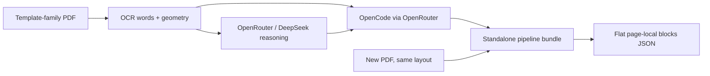
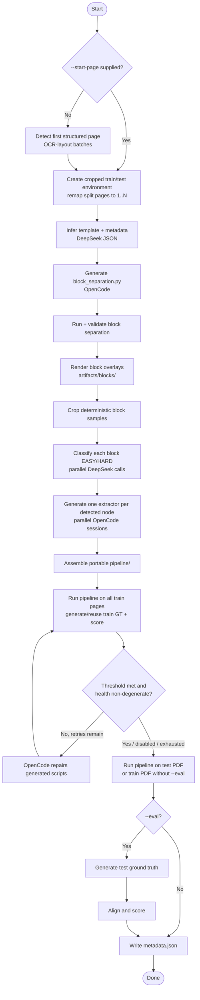
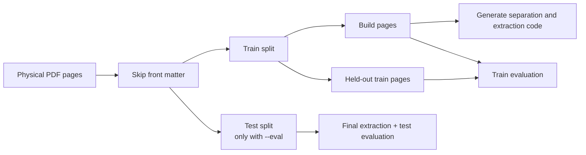
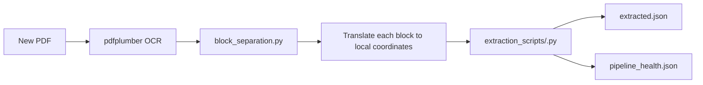
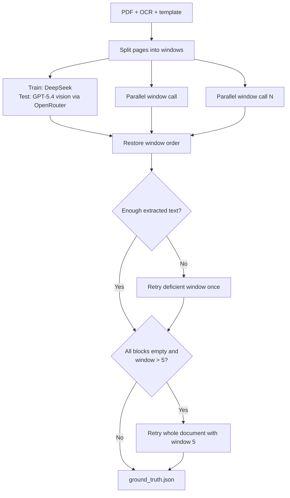
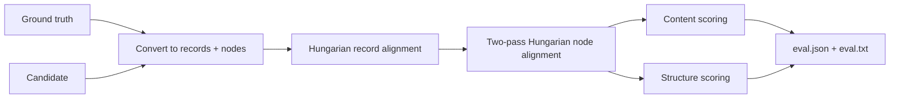

# TWIX 2

TWIX 2 learns a reusable structured-data extraction pipeline from a small set
of pages belonging to one PDF template family.

Given a template-based PDF, it produces:

1. an inferred schema for the document;
2. generated Python code for block detection and field
   extraction;
3. structured JSON extracted by that code;
4. optional train/test evaluation against DeepSeek train ground truth and a
   GPT-5.4 vision reference through OpenRouter on held-out pages;
   and
5. a standalone, model-free `pipeline/` bundle for unseen PDFs with the same
   layout.

The project is thesis research. It is designed for repeated tables and
key-value regions in stable document families, not arbitrary one-off PDFs.

## How the system works

TWIX separates reasoning from repeatable execution. DeepSeek models accessed
through OpenRouter inspect layout-preserving OCR to identify the document's
structure. OpenCode, also routed through OpenRouter, then writes ordinary Python
programs specialized to that structure. Once those programs are built, the
packaged pipeline extracts future documents using only `pdfplumber` and the
Python standard library.



There are two kinds of model-driven work:

- OpenRouter calls to DeepSeek return structured JSON for front-matter
  detection, template inference, easy/hard block routing, and train ground truth.
- OpenRouter calls to GPT-5.4 generate the final reference on never-seen test pages.
- OpenCode sessions use OpenRouter models to write executable Python files for
  block separation, per-block extraction, and optional
  repair.

DeepSeek V4 does not accept image inputs. TWIX therefore serializes each OCR
page into compact lines containing y coordinates and per-word x spans. This
keeps row and column geometry available to the model while using a text-only
API. The PNG block samples remain useful for human debugging, but routing uses
their coordinate JSON.

## Requirements

- Python 3.14
- OpenCode installed and available as `opencode` on `PATH` (DeepSeek recommends
  version 1.14.24 or newer for V4 integration)
- an OpenRouter API key; the same `OPENROUTER_API_KEY` can authenticate direct
  calls and OpenCode's built-in OpenRouter provider

Create the environment:

```bash
python3.14 -m venv env
source env/bin/activate
python -m pip install -r requirements.txt
cp .env.example .env
```

Configure `.env` for OpenRouter and OpenCode:

```dotenv
LLM_PROVIDER=openrouter
OPENROUTER_API_KEY=...
OPENROUTER_MODEL=deepseek/deepseek-v4-flash
OPENROUTER_GROUND_TRUTH_MODEL=openai/gpt-5.4
OPENROUTER_GROUND_TRUTH_MAX_TOKENS=128000
OPENROUTER_REASONING_EFFORT=high
OPENROUTER_TEMPLATE_INFERENCE_REASONING_EFFORT=low

OPENCODE_MODEL=openrouter/deepseek/deepseek-v4-flash
OPENCODE_EASY_MODEL=openrouter/deepseek/deepseek-v4-flash
OPENCODE_HARD_MODEL=openrouter/deepseek/deepseek-v4-pro
```

Direct OpenRouter calls use catalog slugs such as
`deepseek/deepseek-v4-flash`. OpenCode model references add OpenCode's provider
prefix, producing `openrouter/deepseek/deepseek-v4-flash`. To benchmark one
model everywhere, set the direct-call and OpenCode model variables to the
corresponding Flash or Pro ID. Held-out ground truth defaults separately to
`openai/gpt-5.4`. Never commit `.env`.

Authenticate OpenCode through `OPENROUTER_API_KEY`, or run `/connect` in the
OpenCode TUI and choose OpenRouter. The repository's `opencode.json` explicitly
registers both DeepSeek V4 targets; use `/models` to verify the available IDs.

## Quick start

Run on any PDF path:

```bash
python run.py path/to/document.pdf
```

Direct inputs write to `outputs/<pdf-stem>/`. Override that location with:

```bash
python run.py path/to/document.pdf --out-dir artifacts/document-a
```

Run a train/test evaluation and enable repair when train accuracy is below 0.9:

```bash
python run.py path/to/document.pdf \
  --eval \
  --pages 5 \
  --train-threshold 0.9 \
  --train-max-retries 3
```

For the repository's benchmark layout, a dataset name is shorthand for
`data/<name>/<name>.pdf`, and artifacts remain in `data/<name>/`:

```bash
python run.py id_04 --eval --pages 5
```

Run `python run.py --help` for the complete interface. Important options are:

| Option | Meaning |
| --- | --- |
| `--pages N` | Requested number of structured pages in the train split; default `3` |
| `--start-page N` | Use a fixed physical first record page and skip detection |
| `--eval` | Reserve test pages, generate test ground truth, and score |
| `--eval-pages N` | Limit test pages; default is all pages after train |
| `--holdout-pages N` | Hide trailing train pages from script generation but include them in train eval |
| `--no-routing` | Skip difficulty classification and use `OPENCODE_EASY_MODEL` for every block |
| `--train-threshold F` | Repair below this train accuracy; `0` disables repair |
| `--train-max-retries N` | Maximum OpenCode repair rounds; default `3` |
| `--gt-test-window N` | Pages per test-ground-truth call; default `20` |
| `--reuse-ocr` | Reuse the existing full OCR CSV instead of regenerating it |
| `--group-rows` | Experimental row-level OCR instead of word-level OCR |
| `--caveman` | Prefix OpenCode prompts with `/caveman full` |
| `--save-log` | Save OpenCode JSONL output and exact prompts for block separation, extraction, and repair under `debug/` |

`--pages` is a request, not an unconditional count. In eval mode the train split
is capped at half of the usable structured pages so at least one page remains
for test.

## Complete orchestration pipeline

The LangGraph state machine lives in `src/agents/graph.py`.



### 1. OCR and front-matter detection

`run.py` extracts every word with:

```text
id, page, x0, top, x1, bottom, text
```

Word IDs are unique across the source document. Physical page numbers start at
1. OCR is regenerated by default for reproducibility.

Unless `--start-page` is supplied, `detect_beginning.py` sends chronological
batches of six OCR layouts to DeepSeek and asks for the first genuine
structured-record page. Covers, tables of contents, indexes, and narrative
introductions are excluded. If no candidate is found, the conservative fallback
is physical page 1.

### 2. Train/test and holdout creation

`environment_creation.py` crops both the PDF and OCR CSV from the detected start
page. Every split is renumbered locally from page 1, so front matter never
reaches the inferred or generated pipeline.



The automatic holdout is two pages when at least four train pages exist, one
page with three train pages, and zero with one or two. At least two build pages
are always retained. Template inference sees all train-page OCR layouts; the holdout
specifically limits the OCR used to generate and sample the executable scripts.

### 3. Template inference

DeepSeek classifies structured regions as tables or key-value blocks,
orders them top to bottom, identifies optional/nested patterns, describes block
complexity, and emits regexes for fixed document/record metadata.

A node looks like:

```json
{
  "type": "table",
  "fields": ["Period", "Exports - Total", "Imports - Total"],
  "bid": [0],
  "child": -1,
  "node_id": 0,
  "complexity": {
    "same_row_structure": true,
    "nested": false
  }
}
```

`template_inference.py` validates required keys, rejects empty fields, asks once
for duplicate field-name correction, and deterministically suffixes persistent
duplicates. Identical normalized field signatures are flagged because generated
separation code cannot reliably distinguish them by labels alone.

### 4. Generated separation code

OpenCode creates `block_separation.py`. It detects each node's header band,
removes only regex-confirmed page-frame metadata, assigns following content, and
emits page-local continuation blocks when a table flows onto another page.

Each generation phase runs its script immediately and validates its JSON. A
failure is returned to OpenCode for up to three attempts. Generated-script runs
time out after 300 seconds.

After block separation succeeds, the artifact node reapplies the generated
separator to the complete train PDF and `viz_blocks.py` renders every train
page under `<output>/artifacts/blocks/`. Re-running replaces the generated
`page_*_blocks.png` files in that folder.

The key identity rules are:

```text
block_id = <node_id>_<instance-on-page>
template_id = block_id.rsplit("_", 1)[0]
uid = globally unique physical-block identifier
```

A block may contain words only from its own page. Multi-page tables are emitted
as separate physical continuation blocks and are not joined afterward.

### 5. Block samples, routing, and extractors

Up to ten deterministic samples per detected node are cropped from the train
PDF. Each sample has a PNG and a JSON file whose coordinates are relative to
the crop.

Independent DeepSeek calls over the samples' OCR geometry classify each node:

- `EASY` when layout is fixed and values are single-line;
- `HARD` when samples show variable/repeating structure or multi-line values.

The configured easy/hard OpenCode model then writes
`extraction_scripts/<node_id>.py`. These sessions run in parallel. Every script
must define:

```python
def extract(block: dict) -> dict:
    ...
```

The result preserves the template's exact field names and uses `type`,
`block_id`, and `data` keys.

### 6. Packaging and train repair

The collector builds a self-contained directory containing the generated
scripts, `src/pipeline.py`, and its minimal requirements file.

The portable runner is always executed on the complete train PDF and scored
against five-page-window ground truth. This train evaluation happens even when
`--train-threshold` is zero; zero disables only automatic repair.

When repair is enabled, the gate fails if accuracy is below the threshold or
the health report is degenerate. OpenCode receives `train_eval/eval.txt` plus
health violations and may edit only:

- `block_separation.py`; and
- `extraction_scripts/*.py`.

The train ground truth is reused across repair attempts, while pipeline output,
health, score, and accuracy history are regenerated.

## Standalone extraction pipeline

The generated bundle can be copied away from this repository:

```bash
cd <output>/pipeline
python -m pip install -r requirements.txt
python pipeline.py another-document.pdf --out-dir extracted-run
```

The new PDF must belong to the same template family.



The runtime writes:

- `ocr.csv` — runtime OCR words;
- `block_separation.json` — physical page-local blocks;
- `extracted.json` — final flat page-local block output; and
- `pipeline_health.json` — silent-failure and invariants report.

Repeated blocks and same-node table continuations remain separate physical
entries, including when they occur consecutively.

Health is marked degenerate if there are no extracted blocks, blocks appear on
fewer than half of input pages, or any block contains foreign-page words.

## Output data contracts

Block separation:

```json
{
  "pages": [
    {
      "page": 1,
      "blocks": [
        {
          "uid": 0,
          "block_id": "2_0",
          "type": "table",
          "words": []
        }
      ]
    }
  ]
}
```

Final extracted blocks:

```json
[
  {
    "type": "kv",
    "block_id": "0_0",
    "data": {"Invoice #": "A-104", "Date": "2026-08-13"},
    "page": 1,
    "uid": 0
  },
  {
    "type": "table",
    "block_id": "1_0",
    "data": [
      {"Item": "Service", "Amount": "100.00"}
    ],
    "page": 1,
    "uid": 1
  }
]
```

## Ground truth generation

Train and test use the shared generator in `src/agents/gt_common.py`. Train
ground truth sends five-page layout-preserving OCR windows to DeepSeek through
OpenRouter. Final held-out/test ground truth sends rendered page images plus
exact OCR text to `OPENROUTER_GROUND_TRUTH_MODEL` through OpenRouter. Calls are parallel,
results are restored to document order. The model returns flat, page-local
blocks; records and same-node table blocks are never merged. The
default 128,000-token output cap exposes GPT-5.4's full output allowance;
OpenRouter requires the API key's credit limit to cover that maximum. Override
it with `OPENROUTER_GROUND_TRUTH_MAX_TOKENS` when needed.



Suspiciously low content coverage causes one window retry. A completely empty
large-window result retries the entire input with five-page windows; if that is
also empty, the run fails instead of producing a misleading perfect/zero
comparison.

Ground truth is still model-generated. It is a practical experimental reference,
not a substitute for human annotation.

## Evaluation

The evaluator supports grouped records, legacy page/block ground truth, flat
`extracted.json`, and the internal records/nodes shape. Duplicate JSON keys are
preserved during loading as `key`, `key#2`, and so on.



Record similarity combines node-content overlap, type multiset, record size,
and order. Within matched records, node similarity combines type, content, and
parent agreement.

Table content scoring uses:

- multiset header F1 with a longest-common-subsequence order penalty;
- order-preserving row alignment, using exact row anchors and banded
  Needleman-Wunsch for gaps; and
- cell-level F1, including missing/extra rows and wrong-column diagnostics.

Key-value blocks are scored by normalized key/value F1. Missing and extra nodes
also contribute zero-valued content entries, so headline content does not ignore
failed extraction.

The configured headline weights are:

```text
accuracy = 0.40 * typed_node_F1
         + 0.40 * size_weighted_content
         + 0.20 * parent_edge_accuracy
```

The current flat artifacts are partitioned into page-level evaluation records;
their nodes have no parent edges.
For these normal pipeline runs, structure is not applicable and its weight is
renormalized away:

```text
accuracy = 0.50 * typed_node_F1
         + 0.50 * size_weighted_content
```

`RecordMatchF1`, untyped node F1, path accuracy, and note agreement are reported
diagnostics; they do not directly enter the headline value. Evaluation reports
use a fixed `0.9` threshold for PASS/BORDERLINE/FAIL. The repair gate instead
uses `--train-threshold`, whose default is `0.0` (disabled); changing the repair
threshold does not change the report threshold. Neither threshold changes the
score formula.

`eval.json` is machine-readable. `eval.txt` groups actionable reason codes such
as missing records, extra nodes, row loss, cell differences, wrong-column
mapping, and parent mismatches; this report is also the input to repair.

## Artifact layout

```text
<output>/
├── ocr_extraction_full.csv          # source-document OCR
├── template.json                    # inferred schema + metadata regexes
├── metadata.json                    # provenance, config, models, costs, scores
├── metadata/
│   └── cost.json                    # generation-time phase report
├── artifacts/
│   └── blocks/                      # annotated block-separation page PNGs
├── debug/                           # optional partial OpenCode JSONL logs + prompts
├── agent_space/
│   ├── train/                       # eval mode: cropped train PDF/OCR/work files
│   └── test/                        # eval mode: cropped test PDF/OCR
└── pipeline/
    ├── pipeline.py                  # standalone runtime
    ├── requirements.txt             # only pdfplumber
    ├── block_separation.py          # generated
    ├── extraction_scripts/          # generated, one file per detected node
    ├── ocr.csv
    ├── block_separation.json
    ├── extracted.json
    ├── pipeline_health.json
    ├── train_eval/
    │   ├── extracted.json
    │   ├── ground_truth.json
    │   ├── eval.json
    │   ├── eval.txt
    │   ├── eval_history.json
    │   └── pipeline_health.json
    ├── ground_truth.json            # test eval only
    ├── eval.json                    # test eval only
    └── eval.txt                     # test eval only
```

In non-eval mode, `agent_space/` is an unsplit workspace rather than separate
`train/` and `test/` directories.

## Batch experiments

The batch runner discovers folders containing `data/<name>/<name>.pdf`, launches
isolated `run.py` subprocesses, forwards all normal run options, and shows a live
terminal dashboard:

```bash
python src/run_batch.py --jobs 2 --eval --pages 5 --train-threshold 0.9
python src/run_batch.py id_02 id_49 --jobs 2 --eval
```

Each job appends its complete output to `data/<name>/batch.log`. Ctrl-C terminates
running children and reports cancelled jobs.

## Re-evaluation and maintenance tools

Re-score saved artifacts after evaluator changes, without model calls:

```bash
python rescore.py data --dry-run
python rescore.py data
python rescore.py data --doc id_04
```

`rescore.py` hashes `src/eval/*.py` into `eval_version`, rewrites reports, and
patches train/test accuracy in metadata. Use `--dry-run` before rewriting
historical experiments.

Evaluate an existing generated pipeline on another PDF, optionally sampling
pages for ground truth:

```bash
python single_eval.py path/to/new.pdf experiment_a --pages 20 --seed 7
python single_eval.py path/to/new.pdf experiment_a --reuse
```

Regenerate only test ground truth and evaluation for the legacy dataset layout:

```bash
python fix.py id_04 --window 20
```

This overwrites test ground truth/eval and patches `metadata.json` in place.

## Visual diagnostics

```bash
python viz_bb.py id_04 1 2
python viz_blocks.py id_04 1 2
python viz_blocks.py id_04 path/to.pdf
python viz_blocks.py id_04 --pdf-path path/to.pdf
python viz_agent_log.py data/id_04/debug/
python viz_batch_results.py data
```

- `viz_bb.py` draws OCR word boxes.
- `viz_blocks.py` runs `data/<name>/pipeline/block_separation.py` on the chosen
  PDF, then draws colored detected-block bounds and lists detected block
  IDs and types. Its current metadata lookup does not reliably display routing
  models because routing is keyed by node ID while blocks use instance IDs.
- `viz_agent_log.py` renders OpenCode JSONL events, commands, prompts, stderr, and
  token usage.
- `viz_batch_results.py` creates accuracy, token/cost, phase, break-even, and
  per-document charts under `data/results/`.

## Reproducibility and provenance

- Python dependencies are pinned in `requirements.txt`.
- OCR is regenerated by default.
- Block sampling uses a deterministic seed derived from the document name.
- `metadata.json` records the source SHA-256, detected start page, train/test
  split sizes, requested page/holdout settings, repair threshold and retry
  limit, test-ground-truth window, selected models, phase costs, repair history,
  test health failures when degenerate, and train/test scores. It does not
  currently record the resolved automatic holdout size or the `--group-rows`,
  `--reuse-ocr`, `--caveman`, and `--save-log` flags.
- Generated scripts are retained, so extraction can be replayed without the
  original model calls.
- `--save-log` retains exact OpenCode streams and prompts for block separation,
  extraction, and repair.

Remote DeepSeek and OpenCode outputs are not guaranteed to be byte-identical over
time. Preserve the complete artifact directory when an experiment must be
auditable.

Evaluation semantics have evolved. Scores from different scorer versions may
not be comparable even when their field names match. Re-score saved ground truth
and candidate pairs with the current code before combining experiments.

## Development checks

Offline regressions:

```bash
python -m unittest discover -s tests -v
python -m compileall -q run.py fix.py rescore.py single_eval.py src
```

The test suite covers input resolution, page-remapped front-matter cropping,
template validation, duplicate-key-safe JSON parsing, ground-truth empty-output
fallback, page-locality health checks, batch command
construction, and execution of a generated pipeline from a fresh directory.

There is no configured linter. Keep new tests offline: they should not require
the ignored `data/` corpus, credentials, live LLM output, or the OpenCode service.

For deeper contributor guidance and cross-file invariants, see `AGENTS.md`.
