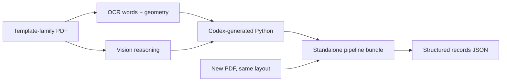
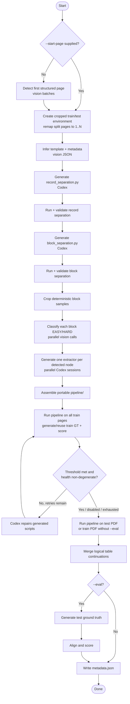
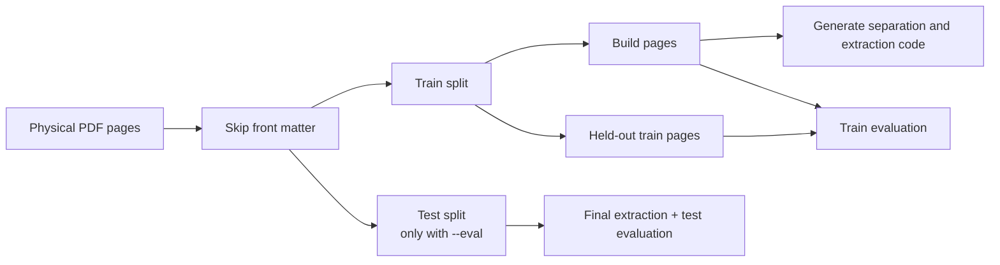
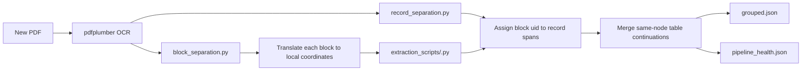
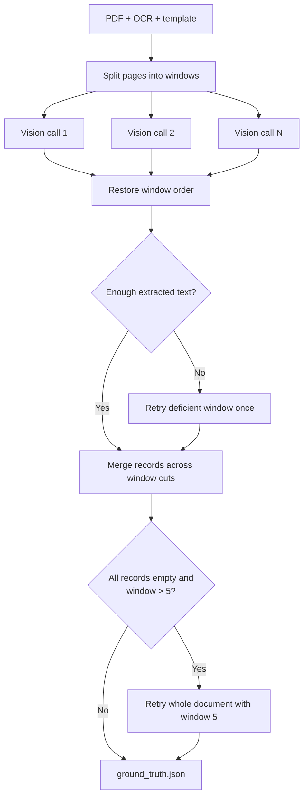
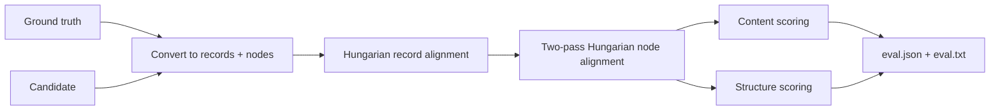

# TWIX 2

TWIX 2 learns a reusable structured-data extraction pipeline from a small set
of pages belonging to one PDF template family.

Given a PDF containing repeated records, it produces:

1. an inferred schema for the document;
2. generated Python code for record detection, block detection, and field
   extraction;
3. structured JSON extracted by that code;
4. optional train/test evaluation against vision-LLM-generated ground truth;
   and
5. a standalone, model-free `pipeline/` bundle for unseen PDFs with the same
   layout.

The project is thesis research. It is designed for repeated tables and
key-value regions in stable document families, not arbitrary one-off PDFs.

## How the system works

TWIX separates reasoning from repeatable execution. Vision models inspect a few
page images to identify the document's structure. The Codex CLI then writes
ordinary Python programs specialized to that structure. Once those programs
are built, the packaged pipeline extracts future documents using only
`pdfplumber` and the Python standard library.



There are two kinds of model-driven work:

- Vision LLM calls return structured JSON for front-matter detection, template
  inference, easy/hard block routing, and ground truth.
- Codex sessions write executable Python files for record separation, block
  separation, per-block extraction, and optional repair.

## Requirements

- Python 3.14
- the `codex` CLI installed, authenticated, and available on `PATH`
- an OpenAI or Azure OpenAI credential

Create the environment:

```bash
python3.14 -m venv env
source env/bin/activate
python -m pip install -r requirements.txt
cp .env.example .env
```

Configure `.env` for OpenAI:

```dotenv
LLM_PROVIDER=openai
OPENAI_API_KEY=...
OPENAI_MODEL=gpt-5.4

CODEX_MODEL=gpt-5.4
CODEX_EASY_MODEL=gpt-5.4-mini
CODEX_HARD_MODEL=gpt-5.4
```

For Azure, set `LLM_PROVIDER=azure` and fill the Azure variables documented in
`.env.example`. Never commit `.env`.

## Quick start

Run on any PDF path:

```bash
python run.py path/to/document.pdf
```

Direct inputs write to `outputs/<pdf-stem>/`. Override that location with:

```bash
python run.py path/to/document.pdf --out-dir artifacts/document-a
```

Run a train/test evaluation and enable repair when train accuracy is below 0.9:

```bash
python run.py path/to/document.pdf \
  --eval \
  --pages 5 \
  --train-threshold 0.9 \
  --train-max-retries 3
```

For the repository's benchmark layout, a dataset name is shorthand for
`data/<name>/<name>.pdf`, and artifacts remain in `data/<name>/`:

```bash
python run.py id_04 --eval --pages 5
```

Run `python run.py --help` for the complete interface. Important options are:

| Option | Meaning |
| --- | --- |
| `--pages N` | Requested number of structured pages in the train split; default `3` |
| `--start-page N` | Use a fixed physical first record page and skip detection |
| `--eval` | Reserve test pages, generate test ground truth, and score |
| `--eval-pages N` | Limit test pages; default is all pages after train |
| `--holdout-pages N` | Hide trailing train pages from script generation but include them in train eval |
| `--train-threshold F` | Repair below this train accuracy; `0` disables repair |
| `--train-max-retries N` | Maximum Codex repair rounds; default `3` |
| `--gt-test-window N` | Pages per test-ground-truth call; default `20` |
| `--reuse-ocr` | Reuse the existing full OCR CSV instead of regenerating it |
| `--group-rows` | Experimental row-level OCR instead of word-level OCR |
| `--caveman` | Prefix Codex prompts with `/caveman full` to reduce output tokens |
| `--save-log` | Save Codex JSONL output and exact prompts under `debug/` |

`--pages` is a request, not an unconditional count. In eval mode the train split
is capped at half of the usable structured pages so at least one page remains
for test.

## Complete orchestration pipeline

The LangGraph state machine lives in `src/agents/graph.py`.



### 1. OCR and front-matter detection

`run.py` extracts every word with:

```text
id, page, x0, top, x1, bottom, text
```

Word IDs are unique across the source document. Physical page numbers start at
1. OCR is regenerated by default for reproducibility.

Unless `--start-page` is supplied, `detect_beginning.py` renders chronological
batches of six pages and asks the vision model for the first genuine
structured-record page. Covers, tables of contents, indexes, and narrative
introductions are excluded. If no candidate is found, the conservative fallback
is physical page 1.

### 2. Train/test and holdout creation

`environment_creation.py` crops both the PDF and OCR CSV from the detected start
page. Every split is renumbered locally from page 1, so front matter never
reaches the inferred or generated pipeline.



The automatic holdout is two pages when at least four train pages exist, one
page with three train pages, and zero with one or two. At least two build pages
are always retained. Template inference sees all train-page images; the holdout
specifically limits the OCR used to generate and sample the executable scripts.

### 3. Template inference

The vision model classifies structured regions as tables or key-value blocks,
orders them top to bottom, identifies optional/nested patterns, describes block
complexity, and emits regexes for fixed document/record metadata.

A node looks like:

```json
{
  "type": "table",
  "fields": ["Period", "Exports - Total", "Imports - Total"],
  "bid": [0],
  "child": -1,
  "node_id": 0,
  "complexity": {
    "same_row_structure": true,
    "nested": false
  }
}
```

`template_inference.py` validates required keys, rejects empty fields, asks once
for duplicate field-name correction, and deterministically suffixes persistent
duplicates. Identical normalized field signatures are flagged because generated
separation code cannot reliably distinguish them by labels alone.

### 4. Generated separation code

The first Codex session creates `record_separation.py`. It groups OCR words into
rows and finds the smallest vertical spans that complete one pass through the
template, with anchor-value guards for multi-page header repetition.

The second creates `block_separation.py`. It detects each node's header band,
removes only regex-confirmed page-frame metadata, assigns following content, and
emits page-local continuation blocks when a table flows onto another page.

Each generation phase runs its script immediately and validates its JSON. A
failure is returned to Codex for up to three attempts. Generated-script runs
time out after 300 seconds.

The key identity rules are:

```text
block_id = <node_id>_<instance-on-page>
template_id = block_id.rsplit("_", 1)[0]
uid = globally unique physical-block identifier
```

A block may contain words only from its own page. Multi-page tables are emitted
as separate physical continuation blocks, then joined after record grouping.

### 5. Block samples, routing, and extractors

Up to ten deterministic samples per detected node are cropped from the train
PDF. Each sample has a PNG and a JSON file whose coordinates are relative to
the crop.

Independent vision calls classify each node:

- `EASY` when layout is fixed and values are single-line;
- `HARD` when samples show variable/repeating structure or multi-line values.

The configured easy/hard Codex model then writes
`extraction_scripts/<node_id>.py`. These sessions run in parallel. Every script
must define:

```python
def extract(block: dict) -> dict:
    ...
```

The result preserves the template's exact field names and uses `type`,
`block_id`, and `data` keys.

### 6. Packaging and train repair

The collector builds a self-contained directory containing the generated
scripts, `src/pipeline.py`, and its minimal requirements file.

The portable runner is always executed on the complete train PDF and scored
against five-page-window ground truth. This train evaluation happens even when
`--train-threshold` is zero; zero disables only automatic repair.

When repair is enabled, the gate fails if accuracy is below the threshold or
the health report is degenerate. Codex receives `train_eval/eval.txt` plus
health violations and may edit only:

- `record_separation.py`;
- `block_separation.py`; and
- `extraction_scripts/*.py`.

The train ground truth is reused across repair attempts, while pipeline output,
health, score, and accuracy history are regenerated.

## Standalone extraction pipeline

The generated bundle can be copied away from this repository:

```bash
cd <output>/pipeline
python -m pip install -r requirements.txt
python pipeline.py another-document.pdf --out-dir extracted-run
```

The new PDF must belong to the same template family.



The runtime writes:

- `ocr.csv` — runtime OCR words;
- `record_separation.json` — logical record spans;
- `block_separation.json` — physical page-local blocks;
- `extracted.json` — extracted block payloads before record grouping;
- `grouped.json` — final record-oriented output; and
- `pipeline_health.json` — silent-failure and invariants report.

Grouping first uses strict page/y containment. A greatest-overlap fallback
handles blocks that straddle a computed record boundary. Same-node table blocks
inside one record are concatenated in physical order.

Health is marked degenerate if there are no extracted blocks, blocks appear on
fewer than half of input pages, any block contains foreign-page words, or more
than 20% of detected records receive no blocks.

## Output data contracts

Record separation:

```json
{
  "records": [
    {
      "record_id": "0",
      "pages": [
        {"page": 1, "y_start": 42.1, "y_end": 701.8, "words": []}
      ]
    }
  ]
}
```

Block separation:

```json
{
  "pages": [
    {
      "page": 1,
      "blocks": [
        {
          "uid": 0,
          "block_id": "2_0",
          "type": "table",
          "words": []
        }
      ]
    }
  ]
}
```

Final grouped records:

```json
[
  {
    "record_id": "0",
    "data": [
      {
        "type": "kv",
        "block_id": "0_0",
        "data": {"Invoice #": "A-104", "Date": "2026-08-13"},
        "page": 1,
        "uid": 0
      },
      {
        "type": "table",
        "block_id": "1_0",
        "data": [
          {"Item": "Service", "Amount": "100.00"}
        ],
        "page": 1,
        "uid": 1
      }
    ]
  }
]
```

## Ground truth generation

Train and test use the shared generator in `src/agents/gt_common.py`; only their
window sizes differ. Each window contains rendered page images and exact OCR
text. Calls are parallel, results are restored to document order, and logical
records cut by window boundaries are merged using template order and repeated
identity values.



The raw pre-merge response is retained as `not_merged_gt.json`. Suspiciously
low content coverage causes one window retry. A completely empty large-window
result retries the entire input with five-page windows; if that is also empty,
the run fails instead of producing a misleading perfect/zero comparison.

Ground truth is still model-generated. It is a practical experimental reference,
not a substitute for human annotation.

## Evaluation

The evaluator supports grouped records, legacy page/block ground truth, flat
`extracted.json`, and the internal records/nodes shape. Duplicate JSON keys are
preserved during loading as `key`, `key#2`, and so on.



Record similarity combines node-content overlap, type multiset, record size,
and order. Within matched records, node similarity combines type, content, and
parent agreement.

Table content scoring uses:

- multiset header F1 with a longest-common-subsequence order penalty;
- order-preserving row alignment, using exact row anchors and banded
  Needleman-Wunsch for gaps; and
- cell-level F1, including missing/extra rows and wrong-column diagnostics.

Key-value blocks are scored by normalized key/value F1. Missing and extra nodes
also contribute zero-valued content entries, so headline content does not ignore
failed extraction.

The configured headline weights are:

```text
accuracy = 0.40 * typed_node_F1
         + 0.40 * size_weighted_content
         + 0.20 * parent_edge_accuracy
```

The grouped artifacts currently convert to flat nodes with no parent edges.
For these normal pipeline runs, structure is not applicable and its weight is
renormalized away:

```text
accuracy = 0.50 * typed_node_F1
         + 0.50 * size_weighted_content
```

`RecordMatchF1`, untyped node F1, path accuracy, and note agreement are reported
diagnostics; they do not directly enter the headline value. The default `0.9`
threshold controls PASS/BORDERLINE/FAIL reporting and the optional train repair
gate, not the score formula.

`eval.json` is machine-readable. `eval.txt` groups actionable reason codes such
as missing records, extra nodes, row loss, cell differences, wrong-column
mapping, and parent mismatches; this report is also the input to repair.

## Artifact layout

```text
<output>/
├── ocr_extraction_full.csv          # source-document OCR
├── template.json                    # inferred schema + metadata regexes
├── metadata.json                    # provenance, config, models, costs, scores
├── metadata/
│   └── cost.json                    # generation-time phase report
├── debug/                           # optional Codex JSONL logs + prompts
├── agent_space/
│   ├── train/                       # eval mode: cropped train PDF/OCR/work files
│   └── test/                        # eval mode: cropped test PDF/OCR
└── pipeline/
    ├── pipeline.py                  # standalone runtime
    ├── requirements.txt             # only pdfplumber
    ├── record_separation.py         # generated
    ├── block_separation.py          # generated
    ├── extraction_scripts/          # generated, one file per detected node
    ├── ocr.csv
    ├── record_separation.json
    ├── block_separation.json
    ├── extracted.json
    ├── grouped.json
    ├── pipeline_health.json
    ├── train_eval/
    │   ├── grouped.json
    │   ├── ground_truth.json
    │   ├── eval.json
    │   ├── eval.txt
    │   ├── eval_history.json
    │   └── pipeline_health.json
    ├── not_merged_gt.json           # test eval only
    ├── ground_truth.json            # test eval only
    ├── eval.json                    # test eval only
    └── eval.txt                     # test eval only
```

In non-eval mode, `agent_space/` is an unsplit workspace rather than separate
`train/` and `test/` directories.

## Batch experiments

The batch runner discovers folders containing `data/<name>/<name>.pdf`, launches
isolated `run.py` subprocesses, forwards all normal run options, and shows a live
terminal dashboard:

```bash
python src/run_batch.py --jobs 2 --eval --pages 5 --train-threshold 0.9
python src/run_batch.py id_02 id_49 --jobs 2 --eval
```

Each job appends its complete output to `data/<name>/batch.log`. Ctrl-C terminates
running children and reports cancelled jobs.

## Re-evaluation and maintenance tools

Re-score saved artifacts after evaluator changes, without model calls:

```bash
python rescore.py data --dry-run
python rescore.py data
python rescore.py data --doc id_04 --remerge
```

`rescore.py` hashes `src/eval/*.py` into `eval_version`, rewrites reports, and
patches train/test accuracy in metadata. Use `--dry-run` before rewriting
historical experiments.

Evaluate an existing generated pipeline on another PDF, optionally sampling
pages for ground truth:

```bash
python single_eval.py path/to/new.pdf experiment_a --pages 20 --seed 7
python single_eval.py path/to/new.pdf experiment_a --reuse
```

Regenerate only test ground truth and evaluation for the legacy dataset layout:

```bash
python fix.py id_04 --window 20
```

This overwrites test ground truth/eval and patches `metadata.json` in place.

## Visual diagnostics

```bash
python viz_bb.py id_04 1 2
python viz_blocks.py id_04 1 2
python viz_blocks.py id_04 --pdf-path path/to.pdf --blocks-json path/to/block_separation.json
python viz_agent_log.py data/id_04/debug/
python viz_batch_results.py data
```

- `viz_bb.py` draws OCR word boxes.
- `viz_blocks.py` draws colored detected-block bounds and annotates model
  routing from metadata.
- `viz_agent_log.py` renders Codex JSONL events, commands, prompts, stderr, and
  token usage.
- `viz_batch_results.py` creates accuracy, token/cost, phase, break-even, and
  per-document charts under `data/results/`.

## Reproducibility and provenance

- Python dependencies are pinned in `requirements.txt`.
- OCR is regenerated by default.
- Block sampling uses a deterministic seed derived from the document name.
- `metadata.json` records the source SHA-256, detected start page, split sizes,
  run configuration, selected models, phase costs, repair history, health
  failures, and train/test scores.
- Generated scripts are retained, so extraction can be replayed without the
  original model calls.
- `--save-log` retains exact Codex streams and prompts for deeper audits.

Remote model and Codex outputs are not guaranteed to be byte-identical over
time. Preserve the complete artifact directory when an experiment must be
auditable.

Evaluation semantics have evolved. Scores from different scorer versions may
not be comparable even when their field names match. Re-score saved ground truth
and candidate pairs with the current code before combining experiments.

## Development checks

Offline regressions:

```bash
python -m unittest discover -s tests -v
python -m compileall -q run.py fix.py rescore.py single_eval.py src
```

The test suite covers input resolution, page-remapped front-matter cropping,
template validation, duplicate-key-safe JSON parsing, ground-truth empty-output
fallback, record grouping, page-locality health checks, batch command
construction, and execution of a generated pipeline from a fresh directory.

There is no configured linter. Keep new tests offline: they should not require
the ignored `data/` corpus, credentials, live LLM output, or the Codex service.

For deeper contributor guidance and cross-file invariants, see `AGENTS.md`.
